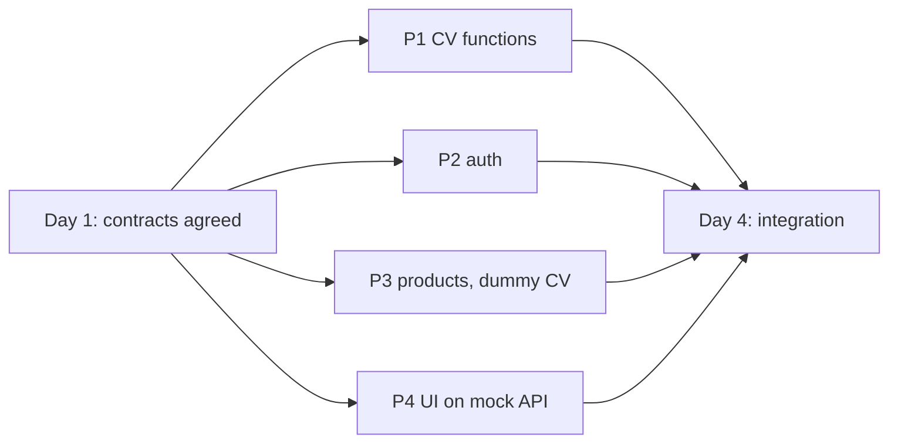

# Sprint 1 team plan

## Who owns what

| Person | Folder | OpenSpec change | Own tables |
| --- | --- | --- | --- |
| P1 | `/cv` | `changes/sprint-1-cv` | none |
| P2 | `/backend/auth` (+ repo, docker-compose) | `changes/sprint-1-auth` | `users`, `otp` |
| P3 | `/backend/products` | `changes/sprint-1-products` | `products`, `shades`, `profiles` |
| P4 | `/frontend` | `changes/sprint-1-frontend` | none |

Fill in names: P1 = ____, P2 = ____, P3 = ____, P4 = ____.

## Why nobody waits



- P1 needs nothing from anyone. P2 and P3 need nothing from each other. P4 uses a mock API.
- P3 imports P1's functions only at integration and uses a dummy function with the same signature until then.
- P3 uses the dev-only `X-Dev-User-Id` header until P2's JWT validator is ready.
- P4 switches the base URL from the mock to the real API on Day 4.

## Timeline (adjust to your sprint length)

| Day | What happens |
| --- | --- |
| 1 | Agree the contracts in `openspec/contracts/` and the open decisions. P2 creates the repo skeleton and docker-compose. |
| 2-3 | Everyone builds inside their own folder. |
| 4 | Integration: P3 swaps the dummy CV for P1's functions and the dev header for P2's JWT validator. P4 switches to the real API. |
| 5+ | Fix integration bugs, run all test cases, record results, finish documents. |

## Early finishers: product database

Whoever finishes first (probably P1) works on shade data. See `shade-data.md`.

## Shared documents (no single owner)

| Document | How it is kept |
| --- | --- |
| `srs.md` | P1 writes the first update once CV work is done; everyone reviews. |
| Sprint backlog and Trello | Each person adds their own cards. Link: ____ |
| `daily-scrum.md` | One file, everyone adds their own entry each day. |
| `user-manual.md` | Each person writes their own section; P4 adds screenshots. |
| `test-results.md` | Each person records their own results, only after running tests. |
| Git repo and docker-compose | P2 sets up on Day 1. |

## Working with OpenSpec

```
openspec list                              # see the four changes
openspec validate --all --strict           # check the documents
openspec status --change sprint-1-cv       # one person's progress
```

Each person works from their own `changes/sprint-1-*/tasks.md` and ticks a box only when the work is done and tested. When a change is finished, archive it with `openspec archive <name>`.

## Folder hygiene

- Write only inside your own folder, plus the shared team documents.
- Never commit secrets. Commit `.env.example` with names only.
- Change a contract only by the rule in `contracts/README.md`.
