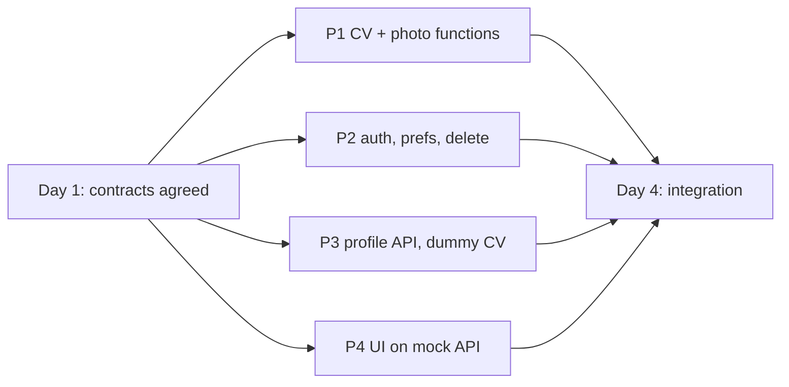

# Sprint 1 team plan

Source requirements: `docs/SRS.pdf` (Hue&Me SRS). Sprint 1 delivers user stories **US1-US10**; Sprint 2 delivers US11+ (shade matching and the rest).

## Who owns what

| Person | Folder | OpenSpec change | Own tables | SRS stories |
| --- | --- | --- | --- | --- |
| P1 | `/cv` | `changes/sprint-1-cv` | none | US6, US7, US8, US9, US10 (analysis logic) |
| P2 | `/backend/auth`, `backend/main.py` (+ repo, docker-compose, Railway) | `changes/sprint-1-auth` | `users`, `password_resets`, `preferences` | US1, US2, US3, US4, US5 |
| P3 | `/backend/products` | `changes/sprint-1-products` | `profiles`, `products`, `shades` | US5 (hook), US6, US7, US8, US9, US10 (endpoints); catalogue as Sprint 2 prep |
| P4 | `/frontend` (+ Vercel) | `changes/sprint-1-frontend` | none | US1-US10 (screens) |

Team (from the SRS): S. Eshaal Gardezi, Momina Ali, Arwa Mahmood, Ayesha Arif.
Assign: P1 = ____, P2 = ____, P3 = ____, P4 = ____.

## Story map

| Story | Priority | P1 (CV) | P2 (auth) | P3 (profile API) | P4 (frontend) |
| --- | --- | --- | --- | --- | --- |
| US1 Registration | High | | signup issues JWT, password ≥ 8 | | signup screen |
| US2 Login / Logout | High | | login, JWT expiry | | login, logout, session survives refresh |
| US3 Password recovery | Medium | | reset link, 1 hour expiry | | forgot / reset screens |
| US4 Preferences | High | | `/me/preferences` | | settings screen, applied app-wide immediately |
| US5 Delete account & data | High | | `DELETE /auth/me` | `delete_user_data` | confirmation dialog, redirect home |
| US6 Selfie analysis | High | `extract_skin_hex` (MediaPipe + OpenCV) | | `POST /profile/photo` | upload screen |
| US7 Manual entry | High | `analyze_skin` | | `PUT /profile` | hex field + swatch grid |
| US8 Seasonal colour type | High | season, confidence, explanation | | `GET /profile` | result screen |
| US9 Wear / avoid colours | High | palette data | | in payload | swatches with hex + text labels |
| US10 Correct detected tone | Medium | `undertone_override` | | `POST /profile/correction` | adjustment controls |
| Sprint 2 prep | Low | `delta_e`, CSV enrichment | | product/shade admin, CSV import | admin screens |

## Tech stack (from the SRS)

| Layer | Choice | Hosting |
| --- | --- | --- |
| Frontend | React / Next.js; mock API with Mock Service Worker (proposal) | Vercel free tier |
| Backend | Python 3.11+, FastAPI, one app mounting the auth and products routers | Railway free tier |
| Database | PostgreSQL | Railway free tier; docker-compose locally |
| Auth | bcrypt, JWT with expiry | |
| Computer vision | MediaPipe Face Mesh (pre-trained), OpenCV (`opencv-python-headless`) | runs inside the backend |
| Process | Scrum, Trello backlog | |

No generative AI, no LLM (templates only), no paid services.

## Why nobody waits



- P1 needs nothing from anyone. P2 and P3 need nothing from each other. P4 uses a mock API.
- P3 imports P1's functions only at integration and uses dummies with the same signatures until then.
- P3 uses the dev-only `X-Dev-User-Id` header until P2's JWT validator is ready.
- P2 uses a no-op stand-in for P3's `delete_user_data` until Day 4.
- P4 switches the base URL from the mock to the real API on Day 4.

## Timeline

The SRS gives 7 weeks for 2 sprints, so Sprint 1 is about 3.5 weeks. "Day N" in the task files is a milestone, not a calendar day:

| Milestone | Suggested week | What happens |
| --- | --- | --- |
| Day 1 | Week 1, start | Agree the contracts and open decisions. P2 creates the repo skeleton, `backend/main.py` and docker-compose. |
| Day 2-3 | Weeks 1-2 | Everyone builds inside their own folder and writes tests. |
| Day 4 | Week 3, start | Integration: P3 swaps the dummy CV for P1's functions and the dev header for P2's JWT validator; P2 wires `delete_user_data`. P4 switches to the real API. First deploy to Railway and Vercel. |
| Day 5+ | Week 3 to sprint end | Fix integration bugs, run all test cases, record results, finish documents, sprint review and retrospective. |

Fill in the real dates: Sprint 1 = ____ to ____, Day 4 = ____.

## Early finishers: product database

Whoever finishes first works on shade data for Sprint 2. See `shade-data.md`.

## Shared documents (no single owner)

| Document | How it is kept |
| --- | --- |
| `docs/SRS.pdf` | The original SRS. Do not edit; record Sprint 1 updates in `srs.md`. |
| `srs.md` | Sprint 1 traceability and updates. P1 writes the first update once CV work is done; everyone reviews. |
| Sprint backlog and Trello | Each person adds their own cards, tagged with the US number. Link: ____ |
| `daily-scrum.md` | One file, everyone adds their own entry each day. |
| `user-manual.md` | Each person writes their own section; P4 adds screenshots. |
| `test-results.md` | Each person records their own results, only after running tests. |
| Git repo, `backend/main.py`, docker-compose, Railway | P2 sets up on Day 1 (repo, compose) and Day 4 (Railway). |
| Vercel project | P4 sets up on Day 4. |

## Working with OpenSpec

```
openspec list                              # see the four changes
openspec validate --all --strict           # check the documents
openspec status --change sprint-1-cv       # one person's progress
```

Each person works from their own `changes/sprint-1-*/tasks.md` and ticks a box only when the work is done and tested. When a change is finished, archive it with `openspec archive <name>`.

## Folder hygiene

- Write only inside your own folder, plus the shared team documents.
- Never commit secrets. Commit `.env.example` with names only.
- Never commit selfies unless they are consented or openly licensed test fixtures with their source recorded.
- Change a contract only by the rule in `contracts/README.md`.
