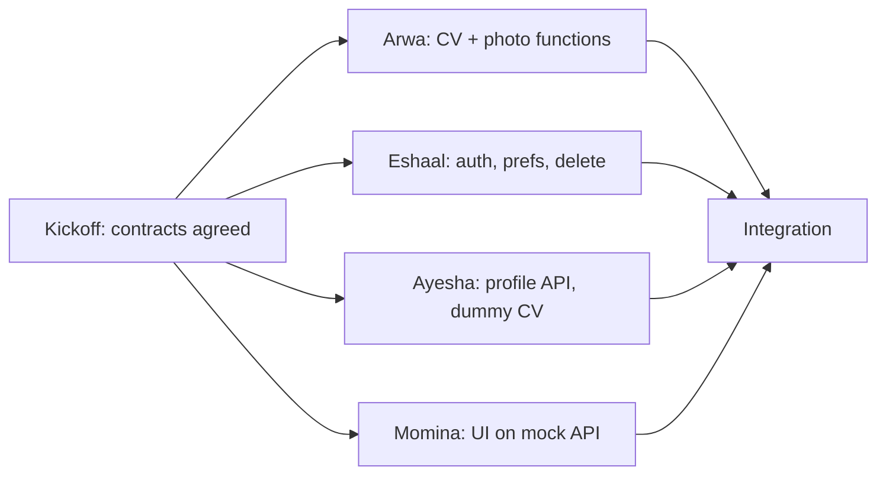

# Sprint 1 team plan

Source requirements: `docs/SRS.pdf` (Hue&Me SRS). Sprint 1 delivers user stories **US1-US10** only. Sprint 2 (US11+) is kept separate in `openspec/sprint-2/` and is not part of any Sprint 1 task list.

## Who owns what

| Person | Folder | OpenSpec change | Own tables | SRS stories |
| --- | --- | --- | --- | --- |
| P1 Arwa | `/cv` | `changes/sprint-1-cv` | none | US6, US7, US8, US9, US10 (analysis logic) |
| P2 Eshaal | `/backend/auth`, `backend/main.py` (+ repo, docker-compose, Railway) | `changes/sprint-1-auth` | `users`, `password_resets`, `preferences` | US1, US2, US3, US4, US5 |
| P3 Ayesha | `/backend/profile` | `changes/sprint-1-profile` | `profiles` | US5 (data deletion), US6, US7, US8, US9, US10 (endpoints) |
| P4 Momina | `/frontend` (+ Vercel) | `changes/sprint-1-frontend` | none | US1-US10 (screens) |

## Story map

| Story | Priority | Arwa (CV) | Eshaal (auth) | Ayesha (profile API) | Momina (frontend) |
| --- | --- | --- | --- | --- | --- |
| US1 Registration | High | | signup issues JWT, password ≥ 8 | | signup screen |
| US2 Login / Logout | High | | login, JWT expiry | | login, logout, session survives refresh |
| US3 Password recovery | Medium | | reset link, 1 hour expiry | | forgot / reset screens |
| US4 Preferences | High | | `/me/preferences` | | settings screen, applied app-wide immediately |
| US5 Delete account & data | High | | `DELETE /auth/me` | `delete_user_data` | confirmation dialog, redirect home |
| US6 Selfie analysis | High | `extract_skin_hex` (MediaPipe + OpenCV) | | `POST /profile/photo` | upload screen |
| US7 Manual entry | High | `analyze_skin` | | `PUT /profile` | hex field + swatch grid |
| US8 Seasonal colour type | High | season, confidence, explanation | | `GET /profile` | result screen |
| US9 Wear / avoid colours | High | palette data | | in payload | swatches with hex + text labels |
| US10 Correct detected tone | Medium | `undertone_override` | | `POST /profile/correction` | adjustment controls |

## Tech stack (from the SRS)

| Layer | Choice | Hosting |
| --- | --- | --- |
| Frontend | React / Next.js; mock API with Mock Service Worker (proposal) | Vercel free tier |
| Backend | Python 3.11+, FastAPI, one app mounting the auth and profile routers | Railway free tier |
| Database | PostgreSQL | Railway free tier; docker-compose locally |
| Auth | bcrypt, JWT with expiry | |
| Computer vision | MediaPipe Face Mesh (pre-trained), OpenCV (`opencv-python-headless`) | runs inside the backend |
| Process | Scrum, Trello backlog | |

No generative AI, no LLM (templates only), no paid services.

## Why nobody waits



- Arwa needs nothing from anyone. Eshaal and Ayesha need nothing from each other. Momina uses a mock API.
- Ayesha uses dummy CV functions with the real signatures until integration, then imports Arwa's.
- Ayesha uses the dev-only `X-Dev-User-Id` header until Eshaal's JWT validator is ready.
- Eshaal uses a no-op stand-in for Ayesha's `delete_user_data` until integration.
- Momina switches the base URL from the mock to the real API at integration.

Each task list is ordered: kickoff tasks first, then building, then integration, then tests and documents.

## Shared documents (no single owner)

| Document | How it is kept |
| --- | --- |
| `docs/SRS.pdf` | The original SRS. Do not edit; record Sprint 1 updates in `srs.md`. |
| `srs.md` | Sprint 1 traceability and updates. Arwa writes the first update once CV work is done; everyone reviews. |
| Sprint backlog and Trello | Each person adds their own cards, tagged with the US number. Link: ____ |
| `daily-scrum.md` | One file, everyone adds their own entry under each scrum's date. |
| `user-manual.md` | Each person writes their own section; Momina adds screenshots. |
| `test-results.md` | Each person records their own results, only after running tests. |
| Git repo, `backend/main.py`, docker-compose, Railway | Eshaal |
| Vercel project | Momina |

## Working with OpenSpec

```
openspec list                              # see the four changes
openspec validate --all --strict           # check the documents
openspec status --change sprint-1-cv       # one person's progress
```

Each person works from their own `changes/sprint-1-*/tasks.md` and ticks a box only when the work is done and tested. When a change is finished, archive it with `openspec archive <name>`.

## Folder hygiene

- Write only inside your own folder, plus the shared team documents.
- Never commit secrets. Commit `.env.example` with names only.
- Never commit selfies unless they are consented or openly licensed test fixtures with their source recorded.
- Change a contract only by the rule in `contracts/README.md`.
